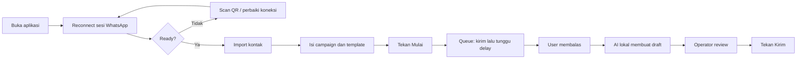

# Spesifikasi Produk MVP

## Tujuan

Menyediakan alat desktop satu operator untuk mengirim satu template campaign melalui satu sesi WhatsApp Web dan membantu operator menyiapkan balasan berdasarkan skill `telesales-quality-check`.

## Keputusan produk

| Area | Keputusan |
|---|---|
| Aktivasi | Operator membuka aplikasi secara manual |
| Akun | Satu nomor WhatsApp per instalasi |
| Ganti nomor | Hapus sesi lama lalu scan QR baru |
| Restart | Aplikasi reconnect ke sesi tersimpan; campaign tidak dimulai otomatis |
| Kontak | CSV, XLSX, atau Google Sheets published CSV |
| Field | Nama dan Nomor |
| Template | Satu template aktif; teks atau gambar |
| Variabel | `{Nama}` |
| Blast | Mulai manual, antrean serial, delay detik tetap |
| Batas harian | Operator mengisi jumlah maksimum penerima per hari; penghitung disimpan lintas restart dan berhenti saat batas tercapai |
| Balasan | Semua pesan masuk diproses saat aplikasi aktif |
| Saran AI | Satu draft terbaik, tidak langsung dikirim |
| Approval | Operator wajib menekan Kirim |
| AI | Runtime llama.cpp dan model Qwen2.5 1.5B dibundel dalam portable |
| Data chat | Tidak disimpan ke metadata |
| Harga/promo | Wajib dicek manual; AI tidak boleh mengarang |
| Risiko pengiriman | UI memberi peringatan heuristik berdasarkan jeda/volume; tidak menjamin bebas pembatasan |
| Operator | Satu operator per instalasi, tanpa login |

Jika aplikasi berhenti setelah WhatsApp mungkin menerima pesan tetapi sebelum metadata tersimpan, kontak diberi status `needs_review`. Campaign tidak boleh diteruskan sampai operator memilih apakah pesan sudah terkirim atau perlu dikirim ulang.

## State machine koneksi

`offline → connecting → qr → authenticated → ready`

Kegagalan autentikasi masuk ke `error`. Koneksi terputus menghentikan campaign aktif dan mengubah status campaign menjadi `paused`.

## State machine campaign

`idle → running → completed`

Operator dapat menghentikan campaign menjadi `paused`. Setelah aplikasi dibuka ulang, status tidak otomatis berubah menjadi `running`.

## Data lokal

Folder data aplikasi Electron:

- `whatsapp-session/`: sesi LocalAuth untuk reconnect.
- `metadata/state.json`: konfigurasi, kontak, status kontak, posisi antrean, dan waktu terakhir diproses.

Isi chat dan riwayat percakapan tidak ditulis ke `state.json`.

## Kontrak saran balasan

Input ke runtime AI lokal:

- campaign
- stage
- audience
- nama kontak
- satu pesan terbaru user

Output yang diminta:

- tepat satu teks balasan siap kirim

Output tidak boleh berisi skor, analisis internal, JSON, harga/promo yang tidak disediakan, atau permintaan OTP/password/PIN.

## Alur operasional

